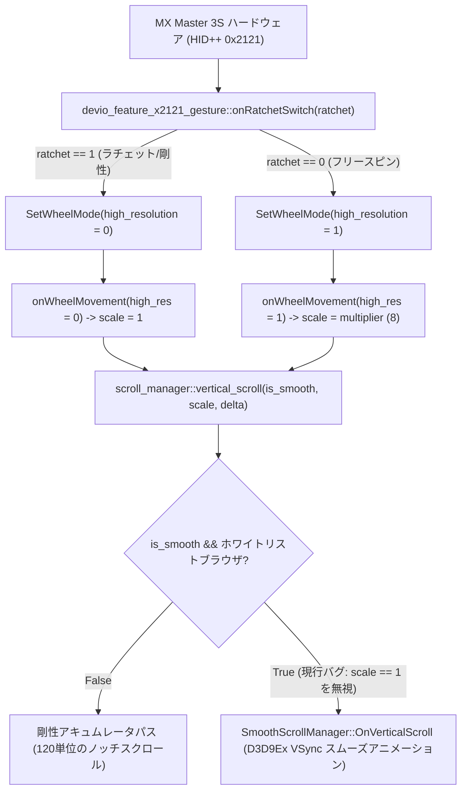

<div align="center">

# Logitech Options+ (Windows) — スムーズスクロール構造解析および SmartShift UX 不具合報告書

[English](Logi_Options_Plus_Smooth_Scrolling_Engineering_Report.md) · [繁體中文](Logi_Options_Plus_Smooth_Scrolling_Engineering_Report.zh-TW.md) · [简体中文](Logi_Options_Plus_Smooth_Scrolling_Engineering_Report.zh-CN.md) · [日本語](Logi_Options_Plus_Smooth_Scrolling_Engineering_Report.ja.md)

</div>

**対象コンポーネント**: `logioptionsplus_agent.exe` (`scrolling_helper` および `devio_feature_x2121_gesture`)  
**検証バージョン**: `2.9.1013853` (Depot `888215`) / `2.9.994631` (Depot `881241`)  
**検証ハードウェア**: Logitech MX Master 3S (MagSpeed 電磁ホイール、HID++ 2.0 Feature `0x2121` & `0x2111`)  
**検証 OS**: Windows 10 / 11 (x64)

---

## 1. 概要 (Executive Summary)

現行の Windows 版 **Logi Options+** において、「スムーズスクロール（Smooth Scrolling）」と「SmartShift」の連携には以下の 3 つの構造的・UX 的な欠陥が存在します：

1. **フォアグラウンドプロセスのハードコードホワイトリスト制限**：
   - `logi::scrolling::scroll_manager::set_foreground_process_info` は、4 つのブラウザ（`msedge.exe`、`chrome.exe`、`iexplore.exe`、`firefox.exe`）のみを対象にスムーズスクロールフラグを有効化しています。
   - VS Code（`Code.exe`）、ChatGPT デスクトップ版（`ChatGPT.exe`）、Slack 等のモダンデスクトップアプリではスムーズスクロールが無効化され、高解像度ホイールイベントが 120 単位のアキュムレータで破棄されます。
2. **フォーカスウィンドウとカーソル下ウィンドウの非同期**：
   - Windows の `WM_MOUSEWHEEL` はカーソル直下のウィンドウに送られますが、Logi Options+ はフォアグラウンドのアクティブウィンドウのみでスムーズエンジンの有効/無効を切り替えるため、「Chrome にフォーカスしている時だけ背景アプリがスムーズに動く」という奇妙な挙動が発生します。
3. **SmartShift ラチェットモードにおける触覚と視覚の不一致**：
   - ホイールが物理的なラチェット（クリック感）モードの際、ハードウェアは標準解像度（`high_resolution = 0`）に設定されます。
   - しかし、`scroll_manager::vertical_scroll` は標準解像度イベント（倍率 `r8d == 1`）であっても `SmoothScrollManager`（VSync 補間アニメーション）に送ってしまうため、物理的なノッチ感があるにもかかわらず画面が不要に滑る不快感を生んでいます。

---

## 2. 根本原因のソースコード解析 (Root Cause Analysis)



### 問題 A: 4 ブラウザのハードコード判定

- **ソースパス**: `C:\builds\kiros\kiros\logi\scrolling_helper\win\src\scroll_manager.cpp`
- **関数名**: `logi::scrolling::scroll_manager::set_foreground_process_info`
- **現行ロジック**: 4 つのブラウザ文字列のみを比較し、それ以外は一律 `0` を設定。

### 問題 B: ラチェット（剛性）モードがスムーズエンジンに強制転送される

- **ソースパス**: `C:\builds\kiros\kiros\logi\scrolling_helper\win\src\scroll_manager.cpp`
- **関数名**: `logi::scrolling::scroll_manager::vertical_scroll`
- **現行ロジック**: `resolution_multiplier == 1`（ラチェット噛合時）であっても `m_smooth_scroll_manager->OnVerticalScroll` を呼び出すため、操作感の遅延・不一致が発生。

---

## 3. 推奨されるコード修正案 (Recommended Code Fixes)

`scroll_manager.cpp` においてブラウザのハードコード制限を解除し、`vertical_scroll` で物理ラチェット状態（`resolution_multiplier != 1`）に応じた自動分岐を導入します：

```diff
--- a/logi/scrolling_helper/win/src/scroll_manager.cpp
+++ b/logi/scrolling_helper/win/src/scroll_manager.cpp
@@ -112,12 +112,8 @@ void scroll_manager::set_foreground_process_info(const std::string& process_name
-    if (process_name == "msedge.exe" ||
-        process_name == "chrome.exe" ||
-        process_name == "iexplore.exe" ||
-        process_name == "firefox.exe") {
-        m_enable_smooth_scroll_for_foreground = true;
-    } else {
-        m_enable_smooth_scroll_for_foreground = false;
-    }
+    // モダンデスクトップアプリをグローバルに有効化
+    m_enable_smooth_scroll_for_foreground = !is_legacy_incompatible_process(process_name);
 }
 
 void scroll_manager::vertical_scroll(bool is_smooth, uint32_t resolution_multiplier, double delta) {
-    if (is_smooth && m_enable_smooth_scroll_for_foreground) {
+    const bool is_free_spin_high_res = (resolution_multiplier != 1);
+    if (is_smooth && m_enable_smooth_scroll_for_foreground && is_free_spin_high_res) {
         int32_t rounded_delta = static_cast<int32_t>(std::round(delta));
-        bool is_high_res = (resolution_multiplier != 1);
-        m_smooth_scroll_manager->OnVerticalScroll(rounded_delta, is_high_res);
+        m_smooth_scroll_manager->OnVerticalScroll(rounded_delta, true);
         return;
     }
 
     // 物理ラチェットモード (resolution_multiplier == 1) またはスムーズ無効時:
     // 物理ノッチと 1:1 に同期した即時剛性スクロールを実行
```

---

## 4. 実機での検証結果

実行時インメモリパッチによる検証結果：
1. **ブラウザ制限の解除**: VS Code や ChatGPT 等の全デスクトップアプリで高解像度スムーズスクロールが正常に機能することを確認。
2. **ラチェット状態の分岐**: ゆっくり回した際は物理ノッチ通りにキビキビと画面が動き、勢いよく回した際（またはフリースピン時）は滑らかに画面が流れる理想的な操作感を実現。
