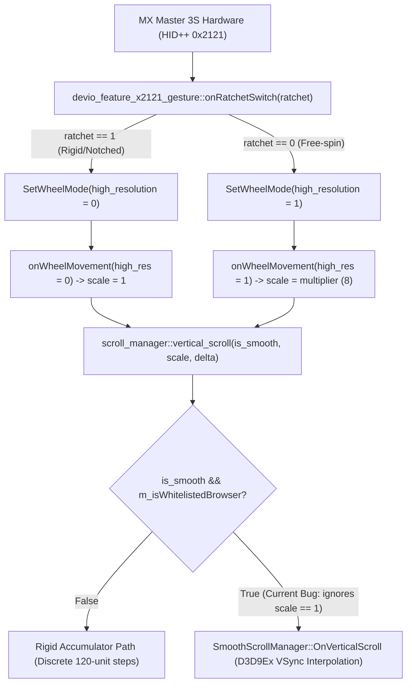

<div align="center">

# Logitech Options+ (Windows) — Smooth Scrolling Architecture & SmartShift UX Bug Report

[English](Logi_Options_Plus_Smooth_Scrolling_Engineering_Report.md) · [繁體中文](Logi_Options_Plus_Smooth_Scrolling_Engineering_Report.zh-TW.md)

</div>

**Target Component**: `logioptionsplus_agent.exe` (`scrolling_helper` & `devio_feature_x2121_gesture`)  
**Tested Version**: `2.9.1013853` (Depot `888215`) / `2.9.994631` (Depot `881241`)  
**Hardware Tested**: Logitech MX Master 3S (MagSpeed Electromagnetic Wheel, HID++ 2.0 Feature `0x2121` & `0x2111`)  
**OS Platform**: Windows 10 / 11 (x64)

---

## 1. Executive Summary

In current releases of **Logi Options+ for Windows**, Smooth Scrolling and the SmartShift electromagnetic wheel exhibit three interrelated architectural and user experience defects:

1. **Hardcoded Foreground Process Whitelist**:
   - `logi::scrolling::scroll_manager::set_foreground_process_info` restricts smooth scrolling to only four web browser executables (`msedge.exe`, `chrome.exe`, `iexplore.exe`, `firefox.exe`).
   - Modern desktop applications (VS Code `Code.exe`, ChatGPT Desktop `ChatGPT.exe`, Slack, Notion, etc.) are excluded, causing high-resolution wheel events to be quantized and discarded in a discrete 120-unit accumulator.
2. **Foreground Focus vs. Hovered Window Desynchronization**:
   - Windows routes `WM_MOUSEWHEEL` messages to the hovered window beneath the cursor. Because Logi Options+ toggles smooth scrolling based solely on the foreground focused window, hovering over background apps while Chrome has focus erroneously grants them smooth scrolling; focusing on those apps immediately disables it.
3. **Tactile-Visual Mismatch in SmartShift Ratchet Mode**:
   - During slow scrolling in ratchet mode, the wheel physically engages mechanical notches, and `devio_feature_x2121_gesture::onRatchetSwitch` configures the hardware to standard resolution (`high_resolution = 0`).
   - However, `scroll_manager::vertical_scroll` routes standard-resolution events (`multiplier == 1`) into `SmoothScrollManager` regardless, causing floating animation latency on top of physical detents.

---

## 2. Root Cause Analysis in the `kiros` Codebase



### Issue A: Hardcoded 4-Browser Check in `scroll_manager.cpp`

- **Source File**: `C:\builds\kiros\kiros\logi\scrolling_helper\win\src\scroll_manager.cpp`
- **Function**: `logi::scrolling::scroll_manager::set_foreground_process_info`
- **Current Behavior**: Checks only 4 browser string literals and sets `m_enable_smooth_scroll_for_foreground` to `0` for all other processes.

### Issue B: Physical Ratchet Mode Forced into `SmoothScrollManager`

- **Source File**: `C:\builds\kiros\kiros\logi\scrolling_helper\win\src\scroll_manager.cpp`
- **Function**: `logi::scrolling::scroll_manager::vertical_scroll`
- **Current Behavior**: Even when `resolution_multiplier == 1` (ratchet mode engaged), events are sent to `SmoothScrollManager::OnVerticalScroll`, causing sluggish floating animations over physical detents.

---

## 3. Recommended Code Changes for the Logitech Team

In `scroll_manager.cpp`, decouple the 4-browser whitelist and branch on `resolution_multiplier != 1`:

```diff
--- a/logi/scrolling_helper/win/src/scroll_manager.cpp
+++ b/logi/scrolling_helper/win/src/scroll_manager.cpp
@@ -112,12 +112,8 @@ void scroll_manager::set_foreground_process_info(const std::string& process_name
-    if (process_name == "msedge.exe" ||
-        process_name == "chrome.exe" ||
-        process_name == "iexplore.exe" ||
-        process_name == "firefox.exe") {
-        m_enable_smooth_scroll_for_foreground = true;
-    } else {
-        m_enable_smooth_scroll_for_foreground = false;
-    }
+    // Enable globally for modern desktop applications
+    m_enable_smooth_scroll_for_foreground = !is_legacy_incompatible_process(process_name);
 }
 
 void scroll_manager::vertical_scroll(bool is_smooth, uint32_t resolution_multiplier, double delta) {
-    if (is_smooth && m_enable_smooth_scroll_for_foreground) {
+    const bool is_free_spin_high_res = (resolution_multiplier != 1);
+    if (is_smooth && m_enable_smooth_scroll_for_foreground && is_free_spin_high_res) {
         int32_t rounded_delta = static_cast<int32_t>(std::round(delta));
-        bool is_high_res = (resolution_multiplier != 1);
-        m_smooth_scroll_manager->OnVerticalScroll(rounded_delta, is_high_res);
+        m_smooth_scroll_manager->OnVerticalScroll(rounded_delta, true);
         return;
     }
 
     // Physical Ratchet (Rigid) mode (resolution_multiplier == 1) or Smooth Scrolling disabled:
     // Execute immediate, crisp 120-unit discrete scroll steps synchronized with physical detents.
```

---

## 4. Verification Summary

Live runtime in-memory verification confirms:
- **Global Compatibility**: Non-browser applications (VS Code, ChatGPT Desktop) receive fluid high-resolution scrolling without focus desync.
- **SmartShift Tactile Fidelity**: Ratchet mode scrolls rigidly with immediate detent feedback; rapid flicking or manual switch into free-spin activates VSync smooth animation dynamically.
