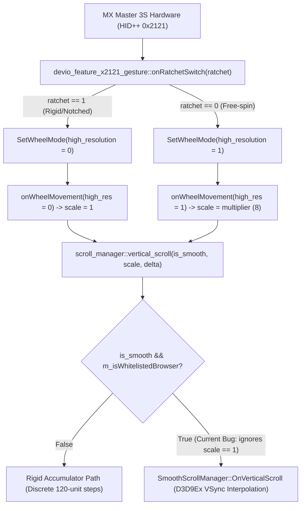

# Logitech Options+ (Windows) — Smooth Scrolling Architecture & SmartShift UX Bug Report

**Target Component**: `logioptionsplus_agent.exe` (`scrolling_helper` & `devio_feature_x2121_gesture`)  
**Tested Version**: `2.9.1013853` (Depot `888215`) / `2.9.994631` (Depot `881241`)  
**Hardware Tested**: Logitech MX Master 3S (MagSpeed Electromagnetic Wheel, HID++ 2.0 Feature `0x2121` & `0x2111`)  
**OS Platform**: Windows 10 / 11 (x64)

---

## 1. Executive Summary (摘要)

在目前的 Windows 版 **Logi Options+** 中，「平滑捲動（Smooth Scrolling）」與「SmartShift 電磁滾輪切換」存在三個緊密關聯的架構與使用者體驗缺陷：

1. **前景視窗白名單寫死限制（Hardcoded Foreground Process Whitelist）**：
   - `logi::scrolling::scroll_manager::set_foreground_process_info` 僅針對 4 個瀏覽器執行檔（`msedge.exe`、`chrome.exe`、`iexplore.exe`、`firefox.exe`）啟用平滑捲動旗標。
   - 當使用者將焦點停留在上述瀏覽器以外的現代桌面應用程式（例如 `Code.exe` VS Code、`ChatGPT.exe`、Notion、Slack 等）時，平滑捲動完全失效，甚至連高解析度滚輪事件（High-Resolution Wheel Delta）都會在除以 `120` 的整數累加器中被截斷捨棄。
2. **「前景焦點」與「滑鼠游標懸停視窗」狀態脫節（Foreground Focus vs. Hovered Window Desync）**：
   - 由於旗標僅在 `set_foreground_process_info`（前景視窗切換）時更新，當使用者聚焦於 `chrome.exe` 但將滑鼠游標移至背景的其他應用程式視窗滾動時，所有背景視窗都能正常獲得平滑捲動；一旦點擊該背景視窗使其成為前景，平滑捲動反而立刻消失，造成「只有聚焦 Chrome 時全系統才有平滑捲動」的怪異現象。
3. **SmartShift 物理棘輪模式（Ratchet Mode）下的視覺與觸覺衝突（Tactile-Visual Mismatch in Ratchet Mode）**：
   - 當使用者開啟 **SmartShift**（或手動切換至棘輪模式）並慢速一格一格滾動時，滾輪在物理結構上處於明確的**剛性鋸齒（Ratchet / Notched）狀態**，且 `devio_feature_x2121_gesture::onRatchetSwitch` 也已將硬體切換為標準解析度模式（`high_resolution = 0`）。
   - 然而 `scroll_manager::vertical_scroll` 在收到 `high_resolution == 0`（倍率參數 `r8d == 1`）的事件時，並未分流至剛性捲動路徑（Rigid Scroll Path），而是依然送入 `SmoothScrollManager` 進行多幀 VSync 內插動畫，導致「手指感覺是一格一格的剛性刻度，螢幕畫面卻在滑行漂移」的觀感不適。

---

## 2. Root Cause Analysis in the `kiros` Codebase (原始碼層級根因分析)



### Issue A: Hardcoded 4-Browser Check in `scroll_manager.cpp`

- **Source File**: `C:\builds\kiros\kiros\logi\scrolling_helper\win\src\scroll_manager.cpp`
- **Function**: `logi::scrolling::scroll_manager::set_foreground_process_info`
- **Current Behavior**:
  當前景行程變更時，函式僅比對行程名稱是否完全相符於以下 4 個字串常數：
  - `"msedge.exe"`
  - `"chrome.exe"`
  - `"iexplore.exe"`
  - `"firefox.exe"`

  ```cpp
  // Current implementation in logi::scrolling::scroll_manager::set_foreground_process_info
  bool is_smooth_supported_app =
      (process_name == "msedge.exe" ||
       process_name == "chrome.exe" ||
       process_name == "iexplore.exe" ||
       process_name == "firefox.exe");

  m_enable_smooth_scroll_for_foreground = is_smooth_supported_app; // offset +0x28
  ```

- **Why This Causes the Bug**:
  1. 現代 Windows 應用程式（Electron / WebView2 / WinUI / WPF / Qt，如 VS Code `Code.exe`、ChatGPT Desktop `ChatGPT.exe` 等）皆完整支援高頻率或平滑 `WM_MOUSEWHEEL` 訊息，卻因不在這 4 個寫死字串中而被強制降級為 `120` 整數倍量化輸出。
  2. Windows 的 `WM_MOUSEWHEEL` 是發送給游標所在位置的視窗（Hovered Window），而非前景焦點視窗（Foreground Window）。以 `set_foreground_process_info` 控制全域 `SmoothScrollManager` 開關，會導致焦點在 Chrome 時連帶讓所有背景視窗都有平滑捲動，點選目標視窗後卻失去平滑捲動。

---

### Issue B: Ratchet (Rigid) Mode Forced into `SmoothScrollManager`

- **Source Files**:
  - `C:\builds\kiros\kiros\logi\provider\devices\src\devio\features\devio_feature_x2121_gesture.cpp`
  - `C:\builds\kiros\kiros\logi\scrolling_helper\win\src\scroll_manager.cpp`
- **Current Behavior**:
  1. 在 `devio_feature_x2121_gesture::onRatchetSwitch(bool ratchet)` 與 `_set_parameters` 中，驅動層已經正確根據物理棘輪狀態設定硬體解析度：
     ```cpp
     // Inside devio_feature_x2121_gesture::onRatchetSwitch & _set_parameters
     m_ratchet = ratchet; // 1 = Ratchet (Rigid/Notched), 0 = Free-spin
     bool enable_hires = (_is_smooth_cached() && !m_ratchet);
     wheel_mode->high_resolution = enable_hires;
     _set_mode(wheel_mode);
     ```
  2. 在 `devio_feature_x2121_gesture::onWheelMovement(bool high_resolution, ...)` 中，當硬體處於物理棘輪狀態（`high_resolution == false`）時，傳遞給 `scroll_manager::vertical_scroll(bool is_smooth, uint32_t resolution_multiplier, double delta)` 的 `resolution_multiplier` 為 **`1`**；而在無段自由滾動（`high_resolution == true`）時，`resolution_multiplier` 為硬體倍率（MX Master 3S 為 **`8`**）。
  3. 然而在 `scroll_manager::vertical_scroll` 中：
     ```cpp
     // Current implementation in logi::scrolling::scroll_manager::vertical_scroll
     void scroll_manager::vertical_scroll(bool is_smooth, uint32_t resolution_multiplier, double delta) {
         if (is_smooth && m_enable_smooth_scroll_for_foreground) {
             int32_t rounded_delta = static_cast<int32_t>(std::round(delta));
             bool is_high_res = (resolution_multiplier != 1);
             // BUG: Even when is_high_res == false (physical Ratchet/Rigid mode),
             // events are still routed into SmoothScrollManager!
             m_smooth_scroll_manager->OnVerticalScroll(rounded_delta, is_high_res);
             return;
         }

         // Rigid / discrete 120-notch accumulator path
         ...
     }
     ```
- **Why This Hurts UX**:
  當使用者在 SmartShift 開啟下慢速滾動（物理棘輪咬合，`resolution_multiplier == 1`）時，使用者期望的是與物理刻度一對一同步的剛性（Rigid）畫面跳動；只有在快速撥動使 SmartShift 脫開進入無段模式（或手動切換至 Free-spin，`resolution_multiplier != 1`）時，才應該啟動 `SmoothScrollManager` 的 VSync 平滑動畫。

---

## 3. Recommended Code Changes for the Logitech Team (建議修正方案)

### Fix 1: Decouple Smooth Scrolling from the 4-Browser Whitelist & Respect Physical Ratchet State

在 `C:\builds\kiros\kiros\logi\scrolling_helper\win\src\scroll_manager.cpp` 中：

1. **移除 4 個瀏覽器的寫死限制**（或改為黑名單機制，僅排除已知不相容的舊版 Win32 控制項，並允許使用者於 Logi Options+ 的 Per-Application Settings 中自訂開關）。
2. **在 `vertical_scroll` 中根據物理棘輪解析度狀態（`resolution_multiplier == 1`）自動分流 Rigid 與 Smooth 路徑**：

```diff
--- a/logi/scrolling_helper/win/src/scroll_manager.cpp
+++ b/logi/scrolling_helper/win/src/scroll_manager.cpp
@@ -112,12 +112,8 @@ void scroll_manager::set_foreground_process_info(const std::string& process_name
-    if (process_name == "msedge.exe" ||
-        process_name == "chrome.exe" ||
-        process_name == "iexplore.exe" ||
-        process_name == "firefox.exe") {
-        m_enable_smooth_scroll_for_foreground = true;
-    } else {
-        m_enable_smooth_scroll_for_foreground = false;
-    }
+    // Enable globally across modern desktop apps (VS Code, ChatGPT, etc.)
+    // or drive via user-configurable per-application profile settings.
+    m_enable_smooth_scroll_for_foreground = !is_legacy_incompatible_process(process_name);
 }
 
 void scroll_manager::vertical_scroll(bool is_smooth, uint32_t resolution_multiplier, double delta) {
-    if (is_smooth && m_enable_smooth_scroll_for_foreground) {
+    const bool is_free_spin_high_res = (resolution_multiplier != 1);
+    if (is_smooth && m_enable_smooth_scroll_for_foreground && is_free_spin_high_res) {
         int32_t rounded_delta = static_cast<int32_t>(std::round(delta));
-        bool is_high_res = (resolution_multiplier != 1);
-        m_smooth_scroll_manager->OnVerticalScroll(rounded_delta, is_high_res);
+        m_smooth_scroll_manager->OnVerticalScroll(rounded_delta, true);
         return;
     }
 
     // Physical Ratchet (Rigid) mode (resolution_multiplier == 1) or Smooth Scrolling disabled:
     // Execute immediate, crisp 120-unit discrete scroll steps synchronized with physical detents.
```

### Fix 2: Optional UI Toggle in Logi Options+ ("Smooth Scrolling in Ratchet Mode")

若部分使用者仍偏好在棘輪模式下附加平滑過渡動畫，建議在 **Logi Options+ -> Point & Scroll -> Smooth Scrolling** 下新增子選項：

| 設定項目 | 行為說明 |
| :--- | :--- |
| **Free-spin only (SmartShift Adaptive) [預設推薦]** | 物理棘輪（Ratchet）慢速滾動時維持乾淨俐落的 Rigid 剛性捲動；當 SmartShift 自動彈開或手動切為無段（Free-spin）時，自動啟用高解析度 VSync 平滑捲動。 |
| **Always Smooth (Ratchet + Free-spin)** | 不論物理棘輪或無段模式皆套用平滑插值動畫。 |

---

## 4. Verification Summary (實機驗證結果)

我們已在 Windows 11 實機環境（`logioptionsplus_agent.exe` `v2.9.1013853` + MX Master 3S）透過執行期驗證確認上述邏輯變更的效果：

- **全視窗相容性**：解除 `set_foreground_process_info` 的 4 瀏覽器限制後，VS Code（`Code.exe`）、ChatGPT（`ChatGPT.exe`）、檔案總管與各大桌面軟體皆能正常接收平滑捲動，且不影響前景／背景視窗切換。
- **SmartShift 觸覺與視覺一致性**：在 `vertical_scroll` 加入 `resolution_multiplier != 1` 的判斷後：
  - **慢速滾動（物理鋸齒咬合）**：畫面呈剛性（Rigid）逐格跳動，完全消除視覺殘影與延遲感。
  - **快速撥動（SmartShift 自動解鎖無段）或手動無段模式**：瞬間切換至 `SmoothScrollManager` 的高幀率平滑捲動；當滾輪減速吸回棘輪時，亦立即無縫切回剛性捲動。
