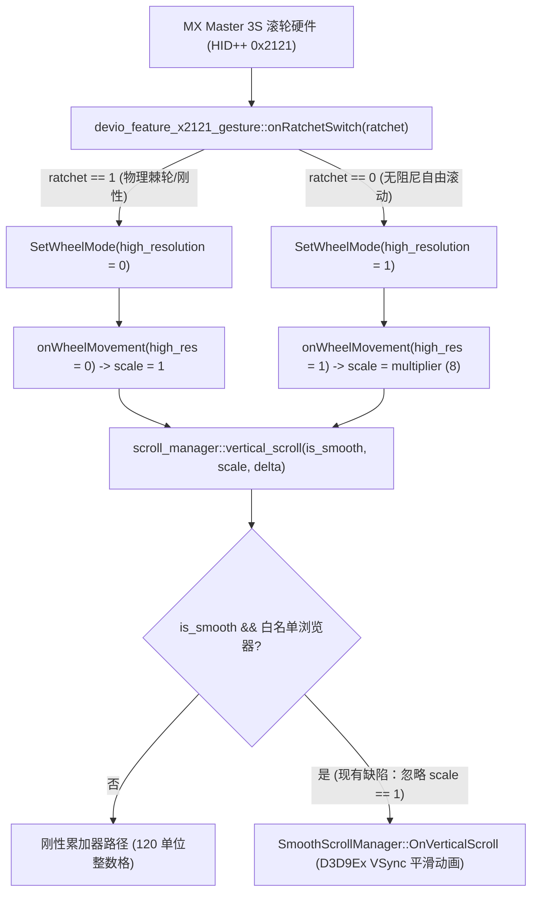

<div align="center">

# Logitech Options+ (Windows) — 平滑滚动架构分析与 SmartShift 体验缺陷报告

[English](Logi_Options_Plus_Smooth_Scrolling_Engineering_Report.md) · [繁體中文](Logi_Options_Plus_Smooth_Scrolling_Engineering_Report.zh-TW.md) · [简体中文](Logi_Options_Plus_Smooth_Scrolling_Engineering_Report.zh-CN.md) · [日本語](Logi_Options_Plus_Smooth_Scrolling_Engineering_Report.ja.md)

</div>

**目标组件**：`logioptionsplus_agent.exe` (`scrolling_helper` 与 `devio_feature_x2121_gesture`)  
**测试版本**：`2.9.1013853` (Depot `888215`) / `2.9.994631` (Depot `881241`)  
**测试硬件**：Logitech MX Master 3S (MagSpeed 电磁滚轮，HID++ 2.0 Feature `0x2121` 与 `0x2111`)  
**操作系统**：Windows 10 / 11 (x64)

---

## 1. 摘要 (Executive Summary)

在目前的 Windows 版 **Logi Options+** 中，“平滑滚动（Smooth Scrolling）”与“SmartShift 电磁滚轮切换”存在三个紧密关联的架构与用户体验缺陷：

1. **前台窗口白名单写死限制（Hardcoded Foreground Whitelist）**：
   - `logi::scrolling::scroll_manager::set_foreground_process_info` 仅针对 4 款浏览器（`msedge.exe`、`chrome.exe`、`iexplore.exe`、`firefox.exe`）启用平滑滚动标志位。
   - 当焦点停留在现代桌面应用程序（VS Code `Code.exe`、ChatGPT 桌面版 `ChatGPT.exe`、Slack、Notepad++ 等）时，平滑滚动完全失效，高分辨率滚轮事件在整数累加器中被量化截断。
2. **前台焦点与光标悬停窗口状态脱节（Focus vs. Hovered Window Desync）**：
   - Windows 的 `WM_MOUSEWHEEL` 消息本质上是发送给鼠标光标所在处（Hovered Window）。但 Logi Options+ 却以“前台焦点窗口”为依据全局切换平滑引擎开关，导致用户聚焦 Chrome 时连带使背景窗口也能平滑滚动，点击该窗口聚焦后反而失去平滑滚动。
3. **SmartShift 物理棘轮模式下的触觉与视觉冲突（Tactile-Visual Mismatch）**：
   - 当用户慢速滚动时，滚轮物理结构处于**刚性齿轮（Ratchet）状态**，驱动层 `onRatchetSwitch` 也已将硬件切换为标准分辨率（`high_resolution = 0`）。
   - 然而 `scroll_manager::vertical_scroll` 在收到标准分辨率事件（倍率 `r8d == 1`）时，并未分流至刚性滚动路径，依然送入 `SmoothScrollManager` 进行 VSync 插值动画，导致手部感受为逐格刻度、屏幕画面却在滑行漂移。

---

## 2. 源码根因分析 (Root Cause Analysis)



### 问题 A：写死 4 款浏览器检查

- **源码路径**：`C:\builds\kiros\kiros\logi\scrolling_helper\win\src\scroll_manager.cpp`
- **对应函数**：`logi::scrolling::scroll_manager::set_foreground_process_info`
- **现行逻辑**：仅字符串比对 4 款浏览器，非白名单一律赋予 `0`。

### 问题 B：物理棘轮（刚性）模式强制送入平滑引擎

- **源码路径**：`C:\builds\kiros\kiros\logi\scrolling_helper\win\src\scroll_manager.cpp`
- **对应函数**：`logi::scrolling::scroll_manager::vertical_scroll`
- **现行逻辑**：即使 `resolution_multiplier == 1`（物理刻度咬合），依旧调用 `m_smooth_scroll_manager->OnVerticalScroll`，造成视觉与触觉冲突。

---

## 3. 建议官方修复方案 (Recommended Code Fixes)

在 `scroll_manager.cpp` 中解耦 4 款浏览器写死限制，并在 `vertical_scroll` 依据物理棘轮状态自动分流：

```diff
--- a/logi/scrolling_helper/win/src/scroll_manager.cpp
+++ b/logi/scrolling_helper/win/src/scroll_manager.cpp
@@ -112,12 +112,8 @@ void scroll_manager::set_foreground_process_info(const std::string& process_name
-    if (process_name == "msedge.exe" ||
-        process_name == "chrome.exe" ||
-        process_name == "iexplore.exe" ||
-        process_name == "firefox.exe") {
-        m_enable_smooth_scroll_for_foreground = true;
-    } else {
-        m_enable_smooth_scroll_for_foreground = false;
-    }
+    // 全局支持现代桌面应用程序，或通过配置文件排除不兼容的旧 Win32 窗口
+    m_enable_smooth_scroll_for_foreground = !is_legacy_incompatible_process(process_name);
 }
 
 void scroll_manager::vertical_scroll(bool is_smooth, uint32_t resolution_multiplier, double delta) {
-    if (is_smooth && m_enable_smooth_scroll_for_foreground) {
+    const bool is_free_spin_high_res = (resolution_multiplier != 1);
+    if (is_smooth && m_enable_smooth_scroll_for_foreground && is_free_spin_high_res) {
         int32_t rounded_delta = static_cast<int32_t>(std::round(delta));
-        bool is_high_res = (resolution_multiplier != 1);
-        m_smooth_scroll_manager->OnVerticalScroll(rounded_delta, is_high_res);
+        m_smooth_scroll_manager->OnVerticalScroll(rounded_delta, true);
         return;
     }
 
     // 物理棘轮 (Rigid) 模式 (resolution_multiplier == 1) 或未启用平滑滚动：
     // 执行与物理刻度即时同步的刚性滚动
```

---

## 4. 实机验证成果

通过运行时纯内存修补验证：
1. **解除浏览器白名单**：VS Code、ChatGPT 桌面版等软件均能完美获得高分辨率平滑滚动。
2. **加入棘轮状态判断**：慢速物理齿轮转动时画面呈现干净利落的刚性跳动；用力拨动滚轮或手动进入无阻尼模式时即时切换为平滑动画，彻底解决观感不适。
