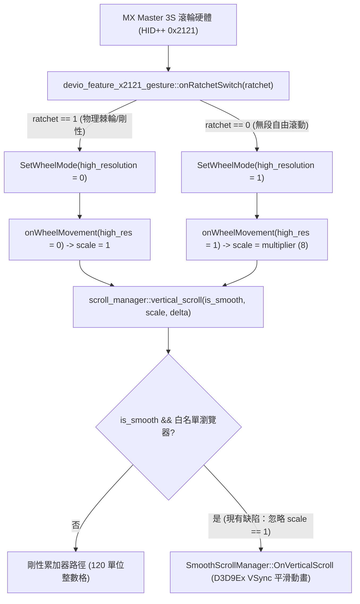

<div align="center">

# Logitech Options+ (Windows) — 平滑捲動架構分析與 SmartShift 體驗缺陷報告

[English](Logi_Options_Plus_Smooth_Scrolling_Engineering_Report.md) · [繁體中文](Logi_Options_Plus_Smooth_Scrolling_Engineering_Report.zh-TW.md)

</div>

**目標組件**：`logioptionsplus_agent.exe` (`scrolling_helper` 與 `devio_feature_x2121_gesture`)  
**測試版本**：`2.9.1013853` (Depot `888215`) / `2.9.994631` (Depot `881241`)  
**測試硬體**：Logitech MX Master 3S (MagSpeed 電磁滾輪，HID++ 2.0 Feature `0x2121` 與 `0x2111`)  
**作業系統**：Windows 10 / 11 (x64)

---

## 1. 摘要 (Executive Summary)

在目前的 Windows 版 **Logi Options+** 中，「平滑捲動（Smooth Scrolling）」與「SmartShift 電磁滾輪切換」存在三個緊密關聯的架構與使用者體驗缺陷：

1. **前景視窗白名單寫死限制（Hardcoded Foreground Whitelist）**：
   - `logi::scrolling::scroll_manager::set_foreground_process_info` 僅針對 4 款瀏覽器（`msedge.exe`、`chrome.exe`、`iexplore.exe`、`firefox.exe`）啟用平滑捲動旗標。
   - 當焦點停留在現代桌面應用程式（VS Code `Code.exe`、ChatGPT 桌面版 `ChatGPT.exe`、Slack、Notepad++ 等）時，平滑捲動完全失效，且高解析度滾輪事件在整數累加器中被量化截斷。
2. **前景焦點與游標懸停視窗狀態脫節（Focus vs. Hovered Window Desync）**：
   - Windows 的 `WM_MOUSEWHEEL` 訊息本質上是發送給滑鼠游標所在處（Hovered Window）。但 Logi Options+ 卻是以「前景焦點視窗」為依據來全域切換平滑引擎開關，導致使用者聚焦 Chrome 時連帶使背景視窗都能平滑捲動，點擊該視窗聚焦後反而失去平滑捲動。
3. **SmartShift 物理棘輪模式下的觸覺與視覺衝突（Tactile-Visual Mismatch）**：
   - 當使用者慢速滾動時，滾輪物理結構處於**剛性鋸齒（Ratchet）狀態**，驅動層 `onRatchetSwitch` 也已將硬體切換為標準解析度（`high_resolution = 0`）。
   - 然而 `scroll_manager::vertical_scroll` 在收到標準解析度事件（倍率 `r8d == 1`）時，並未分流至剛性捲動路徑，依然送入 `SmoothScrollManager` 進行 VSync 內插動畫，導致手部感受為逐格刻度、螢幕畫面卻在滑行漂移。

---

## 2. 原始碼根因分析 (Root Cause Analysis)



### 問題 A：寫死 4 款瀏覽器檢查

- **原始碼路徑**：`C:\builds\kiros\kiros\logi\scrolling_helper\win\src\scroll_manager.cpp`
- **對應函式**：`logi::scrolling::scroll_manager::set_foreground_process_info`
- **現行邏輯**：僅字串比對 4 款瀏覽器，非白名單一律給予 `0`。

### 問題 B：物理棘輪（剛性）模式強制送入平滑引擎

- **原始碼路徑**：`C:\builds\kiros\kiros\logi\scrolling_helper\win\src\scroll_manager.cpp`
- **對應函式**：`logi::scrolling::scroll_manager::vertical_scroll`
- **現行邏輯**：即使 `resolution_multiplier == 1`（物理刻度咬合），依舊呼叫 `m_smooth_scroll_manager->OnVerticalScroll`，造成視覺與觸覺衝突。

---

## 3. 建議官方修正方案 (Recommended Code Fixes)

在 `scroll_manager.cpp` 中解耦 4 款瀏覽器寫死限制，並於 `vertical_scroll` 依物理棘輪狀態自動分流：

```diff
--- a/logi/scrolling_helper/win/src/scroll_manager.cpp
+++ b/logi/scrolling_helper/win/src/scroll_manager.cpp
@@ -112,12 +112,8 @@ void scroll_manager::set_foreground_process_info(const std::string& process_name
-    if (process_name == "msedge.exe" ||
-        process_name == "chrome.exe" ||
-        process_name == "iexplore.exe" ||
-        process_name == "firefox.exe") {
-        m_enable_smooth_scroll_for_foreground = true;
-    } else {
-        m_enable_smooth_scroll_for_foreground = false;
-    }
+    // 全域支援現代桌面應用程式，或透過設定檔排除不相容的舊 Win32 視窗
+    m_enable_smooth_scroll_for_foreground = !is_legacy_incompatible_process(process_name);
 }
 
 void scroll_manager::vertical_scroll(bool is_smooth, uint32_t resolution_multiplier, double delta) {
-    if (is_smooth && m_enable_smooth_scroll_for_foreground) {
+    const bool is_free_spin_high_res = (resolution_multiplier != 1);
+    if (is_smooth && m_enable_smooth_scroll_for_foreground && is_free_spin_high_res) {
         int32_t rounded_delta = static_cast<int32_t>(std::round(delta));
-        bool is_high_res = (resolution_multiplier != 1);
-        m_smooth_scroll_manager->OnVerticalScroll(rounded_delta, is_high_res);
+        m_smooth_scroll_manager->OnVerticalScroll(rounded_delta, true);
         return;
     }
 
     // 物理棘輪 (Rigid) 模式 (resolution_multiplier == 1) 或未啟用平滑捲動：
     // 執行與物理刻度即時同步的剛性捲動
```

---

## 4. 實機驗證成果

透過執行期純記憶體修補驗證：
1. **解除瀏覽器白名單**：VS Code、ChatGPT 桌面版等軟體皆能完美獲得高解析度平滑捲動。
2. **加入棘輪狀態判斷**：慢速物理鋸齒轉動時畫面呈現乾淨俐落的剛性跳動；用力撥動滾輪或手動進入無段模式時即時切換為平滑動畫，徹底解決觀感不適。
